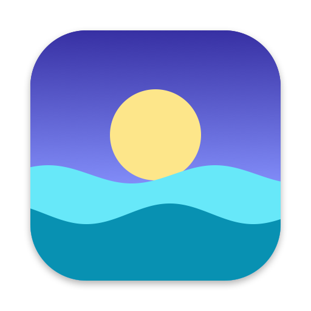

<p align="center">
  
</p>

<h1 align="center">Tidepaper</h1>

<p align="center">
  Live wallpapers for your Mac. Set any video or animated GIF as your desktop background.<br>
  Native, lightweight, free and open source.
</p>

<p align="center">
  <a href="https://github.com/vikas7754/Tidepaper/actions/workflows/build.yml"></a>
  <a href="LICENSE"></a>
  
</p>

## Features

- **Videos and animations** – MP4, MOV and M4V (anything QuickTime Player can play), plus GIF,
  animated PNG and WebP. Looped seamlessly and muted.
- **Every display, every Space** – fills each connected display, follows displays being added
  or rearranged, and stays put in Mission Control. Desktop icons stay clickable on top.
- **Light on resources** – videos are hardware-decoded (about 2% CPU, 16 MB of memory, even for
  4K). Playback pauses by itself when the desktop is covered or the displays sleep, and
  Tidepaper never keeps your Mac awake.
- **Scaling options** – fill, fit, stretch or center, plus sharp nearest-neighbour scaling for
  pixel art.
- **Menu-bar app** – no Dock icon, remembers your wallpaper and recent files, can launch at login.
- **No dependencies** – under 800 lines of Swift on AppKit, AVFoundation, ImageIO and
  Core Animation.

## Install

### Download

1. Download `Tidepaper.zip` from the [latest release](https://github.com/vikas7754/Tidepaper/releases/latest)
   and unzip it.
2. Move `Tidepaper.app` to your Applications folder and open it.
3. Tidepaper isn't notarized by Apple, so the first launch is blocked. Open
   **System Settings › Privacy & Security**, scroll down and click **Open Anyway**. Or run:

   ```sh
   xattr -dr com.apple.quarantine /Applications/Tidepaper.app
   ```

### Build from source

Requires macOS 13 or later and Xcode.

```sh
git clone https://github.com/vikas7754/Tidepaper.git
cd Tidepaper
scripts/build-app.sh --install   # builds a universal app and copies it to /Applications
open /Applications/Tidepaper.app
```

## Usage

Click the Tidepaper icon in the menu bar:

| Menu item | What it does |
|---|---|
| **Choose Wallpaper…** | Pick a video or animated image. It's shown on every display and restored on next launch. |
| **Recent** | Your last 8 wallpapers. |
| **Scaling** | Fill Screen (crop), Fit to Screen (letterbox), Stretch to Fill, or Center (actual size; videos fit instead). |
| **Sharp Pixels** | Nearest-neighbour scaling for pixel-art images. |
| **Pause / Resume** | Stops or restarts the animation. |
| **Show in Finder** / **Remove Wallpaper** | Reveal the current file, or go back to the system wallpaper. |
| **Launch at Login** | Start Tidepaper automatically. |

You can also right-click a file in Finder and choose **Open With › Tidepaper**, or run
`open -a Tidepaper ~/Movies/waves.mp4`.

## Resource use

Measured on an Apple Silicon Mac with two displays. CPU is % of one core; memory is what
Activity Monitor shows.

| Wallpaper | CPU | Memory |
|---|---|---|
| Video, 1080p or 4K | ~2% (plus ~2% in the system video decoder) | ~16 MB |
| GIF whose frames fit in 300 MB once decoded | 0% | size of the frames + ~20 MB |
| Larger GIF, 1080p at 15 / 30 fps | ~13% / ~29% | ~50 MB |
| Anything, with the desktop covered or displays asleep | 0% | unchanged |

macOS's WindowServer also does some extra compositing while anything animates on the desktop.
**Tip:** for big GIFs, convert them to MP4 first; video is much cheaper to play.

## How it works

- Each display gets a borderless, click-through window at desktop level: above the system
  wallpaper, below the desktop icons, on every Space.
- Videos loop gaplessly through `AVPlayerLooper`, hardware-decoded and muted, with display sleep
  left alone.
- Animated images whose frames fit in `FramePlayer.memoryBudget` (300 MB) become a Core Animation
  keyframe animation: decoded once, then played by the system compositor with no CPU from the
  app. Larger ones are streamed, each frame decoded when it's due.
- Window occlusion and display sleep notifications pause playback whenever nothing would be seen.

| File | Role |
|---|---|
| `AppDelegate.swift` | Menu-bar item, menu and actions |
| `WallpaperManager.swift` | One window per display; pausing when hidden |
| `WallpaperWindow.swift` | The desktop-level window |
| `WallpaperContent.swift` | Recognises videos and images |
| `VideoPlayer.swift` / `FramePlayer.swift` | Video and animated-image playback |
| `AnimatedImage.swift` | Frame timing for GIF, APNG and WebP |

## Limitations

- The wallpaper is the same on every display.
- The lock screen keeps the system wallpaper.
- Videos are always muted.

## Contributing

Issues and pull requests are welcome. For development:

```sh
swift run Tidepaper path/to/video.mp4   # run without building the app bundle
swift scripts/make-icon.swift           # regenerate the icon after editing it
```

Please keep the app dependency-free and light on CPU and memory.

## License

[MIT](LICENSE) © 2026 Vikas Singh
